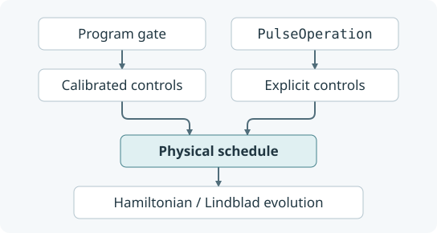

# Write and run pulse programs

Quantum computation is ultimately implemented in physical systems. A gate in
a circuit may correspond to a control pulse on a device, during which the
system also evolves under its own dynamics and interactions. To understand
what happens during that pulse, we need to model the physical system and
calculate how it evolves under its Hamiltonian.

A FatQat emulator takes a [`Program`][fatqat.Program] and follows the state
while the controls are applied. You can use it to see how pulse duration and
coupling affect the result, or how much population leaks into higher levels.
It can also include noise that acts continuously during the evolution.

In digital quantum computation, you describe the computation with gates.
At the pulse level, a gate calibration tells the emulator which control
signals realize each gate. In analog quantum computation, you work with the
system's evolution directly and can specify control pulses to shape its
Hamiltonian over time.

Whether controls come from a gate calibration or a pulse you write directly,
the emulator schedules when to apply them and uses that timing to calculate
the system's evolution.



## Realize a gate with calibrated pulses

Start with a one-qubit Program that applies a single `RX` gate. We run it
with a built-in model of two three-level transmons. The model defines the
physical levels, units, drift, control channels, and coupling.

```pycon
>>> import numpy as np
>>> import fatqat as fq
>>> import fatqat.operations as ops
>>> model = fq.emulator.TransmonModel.from_document(
...     fq.emulator.load_model_document("transmon.reference")
... )
>>> backend = fq.emulator.TransmonEmulator(model)
>>> calibrated_program = fq.Program(1)
>>> calibrated_program.add(ops.RX(np.pi / 2), 0)
>>> calibrated_result = backend.run(calibrated_program).result()
>>> calibrated_result.get_statevector().shape
(9, 1)
```

When the emulator runs `RX`, its gate implementation map supplies a calibrated
pulse on the drive channel for the addressed transmon. The returned state is a
QuTiP ket `Qobj` with $3^2$ amplitudes because it describes both three-level
transmons in the model. Including the third level lets you see population leak
out of the qubit states `|0>` and `|1>`.

To model a different system or use a different calibration, supply its model
document and gate implementation map.

## Specify a control pulse directly

Use the same model to see how a waveform of your choice drives a transmon.
A [`SampledWaveform`][fatqat.emulator.SampledWaveform] sets the signal at three
times. A [`PulseControl`][fatqat.emulator.PulseControl] sends it to a physical
drive channel, and a [`PulseOperation`][fatqat.operations.PulseOperation] sets
the duration of the control block.

```pycon
>>> duration = 20.0
>>> waveform = fq.emulator.SampledWaveform(
...     (0.0, 10.0, duration),
...     (0.0, 0.02, 0.0),
... )
>>> control = fq.emulator.PulseControl(
...     model.control.drive("q0"),
...     waveform,
... )
>>> pulse = ops.PulseOperation(duration=duration, controls=(control,))
>>> direct_program = fq.Program(1)
>>> direct_program.add(pulse)
>>> direct_result = backend.run(direct_program).result()
>>> direct_result.get_statevector().shape
(9, 1)
```

In `direct_program.add(pulse)`, the drive channel already specifies physical
transmon `q0`. A [`ResourceLayout`][fatqat.ResourceLayout] maps logical qubits
to physical positions. The pulse uses the physical address and the time and
signal units defined by the model and its channel.

## How the state evolves during a pulse

In the example above, the drive is zero at time 0, reaches 0.02 at time 10,
and returns to zero at time 20. The emulator interpolates between those three
samples to get a continuous waveform. At each instant, the drive combines
with drift and coupling to determine the Hamiltonian and how the quantum
state changes.

## Schedule multiple pulses

The schedule determines when each pulse block starts. Two blocks that use the
same drive channel run one after the other, in Program order. Blocks can
overlap when their physical resources are independent. Use `execution_config`
to choose `"ASAP"` or `"ALAP"` for the earliest or latest valid start times.
Within one `PulseOperation`, use `start_offset` to delay an individual waveform
relative to the start of that block.

Drift and background continuous noise evolve throughout elapsed time. On an
emulator that supports classical conditions, a false condition can skip a
control block without deleting its duration, so the model still evolves during
the interval. This lets you study the effect of elapsed time even when no
control is active.

Choose `method` when creating the emulator to set the representation used for
the simulation and the corresponding Result accessor. The options are
`statevector` (the default), `density_matrix`, and `unitary`.

For pulse object,
schedule, simulation-method, and model contracts, use the
[pulse-control API](../api/pulse-control/index.md) and
[emulator API](../api/emulators/index.md).
