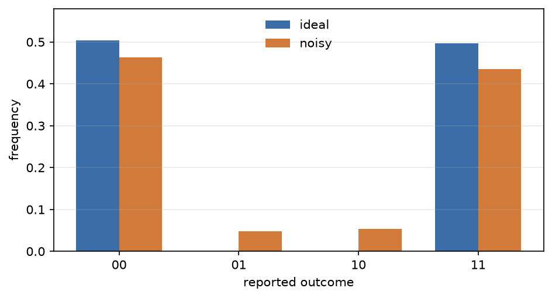

# Compare the same Program ideally and noisily

Attach a [`NoiseModel`][fatqat.NoiseModel] to a simulator to study how errors
affect your results. The model specifies which errors occur and where they
apply; you can run the same [`Program`][fatqat.Program] with or without it.

This example compares measurements of a Bell pair before and after adding
gate noise and readout errors.

## Establish an ideal baseline

Prepare a Bell pair and measure both qubits:

```pycon
>>> import fatqat as fq
>>> import fatqat.operations as ops
>>> bell = fq.Program(2, 2)
>>> bell.add(ops.H, 0)
>>> bell.add(ops.CX, (0, 1))
>>> bell.measure_all()
>>> ideal_backend = fq.simulator.Simulator(
...     method="density_matrix",
...     runtime="numpy",
... )
>>> ideal_counts = ideal_backend.run(
...     bell,
...     shots=4_000,
...     execution_config={"seed": 7},
... ).result().get_counts()
>>> ideal_counts
{'00': 2013, '11': 1987}
```

The two measured bits always agree. Each outcome has exact probability 0.5,
but their counts differ slightly because the simulator samples 4,000 shots.

## Add gate and readout noise

Use `operation=ops.CX` to apply depolarizing noise after each `CX` gate.
Here, `p=0.12` mixes 88% of the two-qubit state with 12% of the maximally
mixed state, which gives all four computational-basis outcomes equal
probability. This acts jointly on the gate's two operands.

Add readout confusion to model incorrectly reported bits. In the matrix below,
columns identify the true bit and rows identify the reported bit: a true `0`
is reported as `1` with probability 0.02, and a true `1` as `0` with
probability 0.04. Without a target selector, this applies to each measured
qubit.

Pass the noise model to another simulator:

```pycon
>>> noise = fq.NoiseModel()
>>> noise.add(
...     fq.noise.Depolarizing(p=0.12),
...     operation=ops.CX,
... )
>>> noise.add(
...     fq.noise.ReadoutConfusion(
...         [[0.98, 0.04], [0.02, 0.96]]
...     )
... )
>>> noisy_backend = fq.simulator.Simulator(
...     method="density_matrix",
...     runtime="numpy",
...     noise=noise,
... )
>>> noisy_counts = noisy_backend.run(
...     bell,
...     shots=4_000,
...     execution_config={"seed": 7},
... ).result().get_counts()
>>> noisy_counts
{'00': 1853, '01': 201, '10': 204, '11': 1742}
>>> disagreements = noisy_counts.get("01", 0) + noisy_counts.get("10", 0)
>>> round(disagreements / sum(noisy_counts.values()), 3)
0.101
```

The reported bits disagree in about 10.1% of these shots. Gate noise changes
the quantum state, while readout confusion changes the reported bits. Both
can produce `01` and `10`, so these counts alone do not tell you which error
occurred. The unequal readout probabilities also favor reported zeros,
shifting the balance between `00` and `11`.



??? example "Reproduce this figure"

    ```python
    import numpy as np
    import matplotlib.pyplot as plt
    import fatqat as fq
    import fatqat.operations as ops

    bell = fq.Program(2, 2)
    bell.add(ops.H, 0)
    bell.add(ops.CX, (0, 1))
    bell.measure_all()

    noise = fq.NoiseModel()
    noise.add(fq.noise.Depolarizing(p=0.12), operation=ops.CX)
    noise.add(
        fq.noise.ReadoutConfusion(
            [[0.98, 0.04], [0.02, 0.96]]
        )
    )

    ideal_backend = fq.simulator.Simulator(
        method="density_matrix", runtime="numpy"
    )
    noisy_backend = fq.simulator.Simulator(
        method="density_matrix", runtime="numpy", noise=noise
    )
    shots = 4_000
    run_options = {"shots": shots, "execution_config": {"seed": 7}}
    ideal = ideal_backend.run(bell, **run_options).result().get_counts()
    noisy = noisy_backend.run(bell, **run_options).result().get_counts()

    labels = ["00", "01", "10", "11"]
    ideal_frequency = np.array([ideal.get(label, 0) for label in labels]) / shots
    noisy_frequency = np.array([noisy.get(label, 0) for label in labels]) / shots

    x = np.arange(len(labels))
    width = 0.36
    fig, ax = plt.subplots(figsize=(6.4, 3.5))
    ax.bar(
        x - width / 2,
        ideal_frequency,
        width,
        label="ideal",
        color="#3b6ea8",
    )
    ax.bar(
        x + width / 2,
        noisy_frequency,
        width,
        label="noisy",
        color="#d17a3a",
    )
    ax.set(
        xlabel="reported outcome",
        ylabel="frequency",
        xticks=x,
        xticklabels=labels,
        ylim=(0.0, 0.58),
    )
    ax.legend(frameon=False)
    ax.grid(axis="y", alpha=0.25)
    fig.tight_layout()
    plt.show()
    ```

## Density matrices and sampled trajectories

The density-matrix method used here calculates the noisy state directly.
Measurement counts are still sampled, so repeating a run with a different
seed changes the counts.

A statevector simulator can also run this noise model. It samples individual
noise trajectories, using less memory to represent the state. This is useful
for larger circuits where storing a density matrix is too expensive. More
shots improve the precision of the sampled distribution.

Both methods describe the same noise model and should give statistically
consistent measurement frequencies. Use a density matrix when you need the
noisy state or an expectation value without sampling noise trajectories.

## Circuit channels and continuous noise

| Execution level | Noise description | Where it acts |
| --- | --- | --- |
| Circuit simulator | finite probabilities and channels | at matched operation boundaries |
| Physical emulator | rates and relaxation times | throughout elapsed Hamiltonian/Lindblad evolution |

Circuit noise probabilities and continuous-time rates require different
inputs; FatQat does not convert between them automatically. Move to
[Hamiltonian-level emulation](hamiltonian-emulation.md) for pulse duration,
idle evolution, leakage, or continuous-time noise. For supported combinations,
selectors, and validation rules, see the [noise-backend-support](../api/noise/backend-support.md#noise-backend-support) table
and [Noise model API](../api/noise/model.md).
