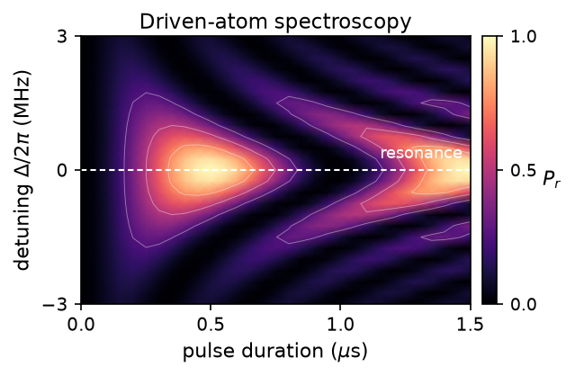

# User guide

Choose the level of detail that answers your question. Direct simulation and
physics workflows start from the same backend-independent
[`Program`][fatqat.Program]. When mapping and routing are part of the question,
author a [`LogicalProgram`][fatqat.LogicalProgram] for the
[compiler](compiler.md).

!!! tip "New to FatQat?"

    [Build, draw, and run a Bell program](quickstart.md), then learn how to
    [write Programs and registers](program.md). When you are ready to compare
    backends, [choose a simulation or emulation approach](execution-models.md).

## Choose an approach

-   { loading=lazy width="636" height="409" }

    :material-chart-bell-curve-cumulative: **Explore the algorithm**

    Simulate states, measurements, observables, and parameter sweeps, then
    compare ideal and noisy results or tune performance.

    [Start with simulation :material-arrow-right:](simulation.md)

-   { loading=lazy width="490" height="400" }

    :material-chip: **Test hardware constraints**

    Check native operations, placement, connectivity, capacity, atom occupancy,
    pairing, and reference noise.

    [Explore hardware constraints :material-arrow-right:](hardware-constraints.md)

-   { loading=lazy width="639" height="418" }

    :material-atom: **Follow the physics**

    Follow calibrated transmon gates and direct pulse controls as continuous
    dynamics, with built-in models for transmons and neutral atoms.

    [Explore physical dynamics :material-arrow-right:](hamiltonian-emulation.md)

[Compare approaches](execution-models.md) if you are unsure which
path contains the detail your study needs.

## Browse by task

-   :material-chart-box-outline:{ .lg .middle } **Run & analyze**

    ---

    [Simulate programs](simulation.md) ·
    [Observables](interpret-results.md) ·
    [Ideal and noisy runs](ideal-and-noisy.md) ·
    [Visualize results](visualization.md) ·
    [Improve performance](performance.md)

-   :material-memory:{ .lg .middle } **Hardware constraints**

    ---

    [Superconducting qubits](superconducting-simulation.md) ·
    [Neutral-atom arrays](atom-array-simulation.md) ·
    [Linear optics](linear-optics.md) ·
    [Compile circuits](compiler.md)

-   :material-atom:{ .lg .middle } **Hamiltonian emulation**

    ---

    [Pulse programs](hamiltonian-emulation.md) ·
    [Transmons](transmon-emulation.md) ·
    [Neutral atoms](neutral-atom-emulation.md)

-   :material-transit-connection-variant:{ .lg .middle } **Connect & debug**

    ---

    [OpenQASM & Qiskit](interoperability.md) ·
    [Troubleshooting](troubleshooting.md)

!!! tip

    The guide teaches complete workflows and the reasoning behind them. Follow a
    link to the [API reference](../api/index.md) when you need a precise signature
    or contract. The [tutorials](../tutorials/index.md) are longer case studies
    built on the same features.
