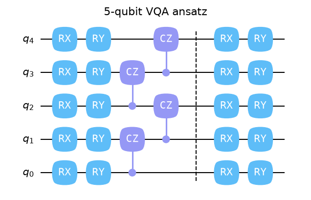
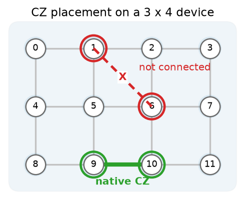

# User guide

In FatQat, you can change the conditions of a run while keeping the calculation
you wrote. To see how noise affects measurement outcomes, run the same
[`Program`][fatqat.Program] with and without a noise model. In a pulse
experiment, you can keep the laser drive fixed, change the distance between two
atoms, and see how likely both atoms are to be excited.

The question also determines which result to read. Measurement counts show how
often each outcome appears. An expectation value can reveal differences that
counts in one basis miss. When the control pulse itself matters, you can compare
the final states for different pulse shapes or durations.

!!! tip "New to FatQat?"

    Start by [writing, drawing, and running a Bell program](quickstart.md).
    Learn how to organize the program's resources in [Program and registers](program.md).

## Browse by task

-   { loading=lazy width="636" height="409" }

    :material-chart-bell-curve-cumulative: **Run and analyze**

    Sweep a parameter to see how the result changes, or compare an estimate
    from measurements with an exact expectation value.

    [Simulate programs](simulation.md) ·
    [Estimate observables](interpret-results.md) ·
    [Compare ideal and noisy runs](ideal-and-noisy.md) ·
    [Visualize results](visualization.md) ·
    [Improve performance](performance.md)

-   { loading=lazy width="490" height="400" }

    :material-chip: **Test hardware constraints**

    Check which gates a device supports and where they can run. Use a
    [`LogicalProgram`][fatqat.LogicalProgram] if you want the compiler to adapt
    a logical circuit to the device.

    [Hardware constraints](hardware-constraints.md) ·
    [Superconducting qubits](superconducting-simulation.md) ·
    [Neutral-atom arrays](atom-array-simulation.md) ·
    [Linear optics](linear-optics.md) ·
    [Compile circuits](compiler.md)

-   { loading=lazy width="639" height="418" }

    :material-atom: **Study pulse dynamics**

    Compare the reference pulse for a gate with a pulse you specify. Use the final state to
    see, for example, how much probability ends up in a higher transmon level.

    [Write and run pulse programs](hamiltonian-emulation.md) ·
    [Transmon emulation](transmon-emulation.md) ·
    [Neutral-atom emulation](neutral-atom-emulation.md)

[Compare simulation and emulation approaches](execution-models.md) to see what
each model includes.

## Connect and troubleshoot

[Work with OpenQASM and Qiskit](interoperability.md) ·
[Troubleshoot common problems](troubleshooting.md)

For exact interface details, see the [API reference](../api/index.md). For
complete computational experiments, see the [case studies](../tutorials/index.md).
