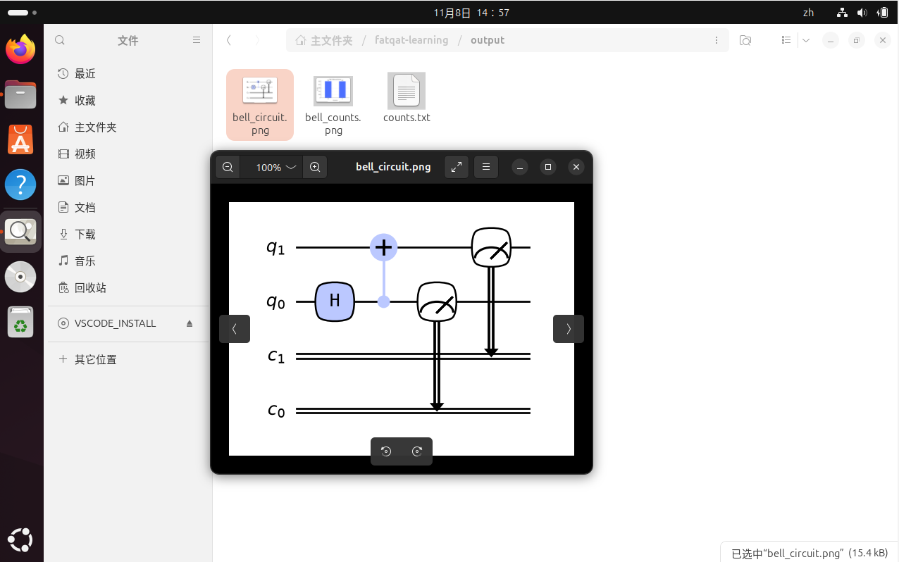
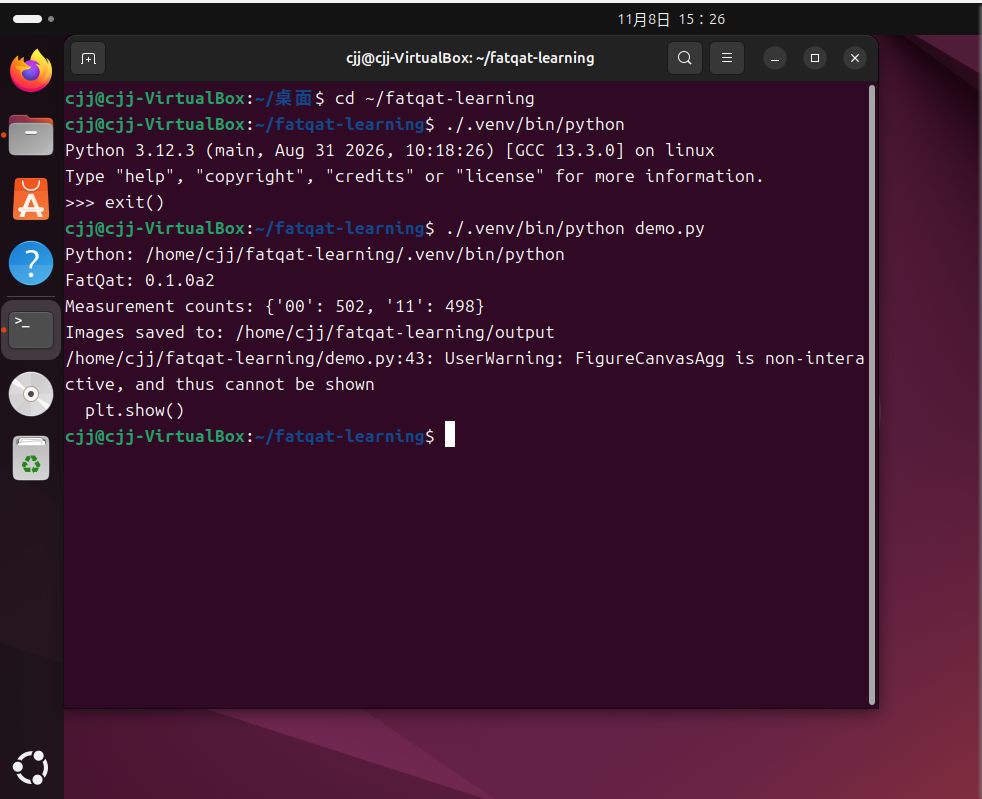
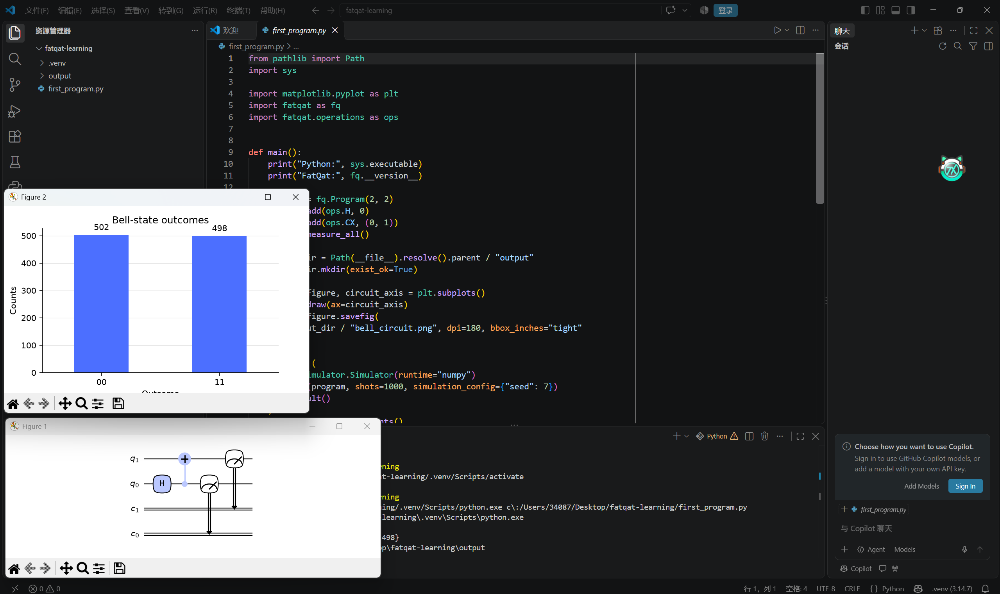

# 安装 FatQat，运行第一个程序

这一页从准备 Python 开始，带你运行一个贝尔态程序，把测量结果和电路图保存下来。最后介绍如何在 Windows 的 VS Code 中点击按钮运行。

## 准备 Python

FatQat 需要 Python 3.12 或更新版本。如果还没有安装，可以从 [Python 官网](https://www.python.org/downloads/)下载安装。Linux 用户也可以使用系统的软件包管理器。

打开终端：Windows 在开始菜单中搜索 PowerShell；macOS 打开“终端”；Linux 打开系统的终端应用。

下面这样的安装命令在终端里输入，每条命令输入完整后再按回车。后面以 `import` 开头的 Python 代码则保存到文件中。

先查看 Python 版本。

Windows：

```powershell
python --version
```

macOS / Linux：

```bash
python3 --version
```

确认版本不低于 3.12。如果 Windows 找不到 `python`，但安装时提供了 `py` 命令，可以用 `py --version` 检查，并在下面创建环境时用 `py` 替代 `python`。

## 创建一个学习文件夹

在终端中依次执行：

```sh
mkdir fatqat-learning
cd fatqat-learning
```

示例和运行结果都放在这个文件夹里。之后重新打开终端时，记得先回到它所在的位置，再执行后面的命令。

接下来创建一个名为 `.venv` 的 Python 环境，专门保存这个项目需要的库。

Windows：

```powershell
python -m venv .venv
```

macOS / Linux：

```bash
python3 -m venv .venv
```

如果 Ubuntu 提示缺少 `venv`，需要先安装对应组件。例如 Ubuntu 24.04 自带的 Python 3.12 可以执行：

```bash
sudo apt update
sudo apt install python3.12-venv
```

安装完成后，重新执行创建环境的命令。其他 Linux 版本的软件包名称可能不同。

## 安装 FatQat

下面的命令直接使用 `.venv` 里的 Python，不需要先激活环境。

Windows：

```powershell
.\.venv\Scripts\python.exe -m pip install fatqat
```

macOS / Linux：

```bash
./.venv/bin/python -m pip install fatqat
```

看到 `Successfully installed`，且没有安装失败的错误，就可以继续。下载和安装依赖可能需要几分钟。

### 使用源码版本

如果想使用项目源码，先下载源码并进入包含 `pyproject.toml` 的文件夹，在那里创建 `.venv`。然后把上面安装命令最后的 `fatqat` 换成 `.`。

Windows：

```powershell
.\.venv\Scripts\python.exe -m pip install .
```

macOS / Linux：

```bash
./.venv/bin/python -m pip install .
```

这里的 `.` 表示当前文件夹。发布版本和源码版本可能不同，请阅读对应版本的教程。

## 保存第一个程序

用文本编辑器新建 `first_program.py`，保存在 `fatqat-learning` 中，把下面的完整代码复制进去。注意文件名不要变成 `first_program.py.txt`，也不要命名为 `fatqat.py`。

这个程序创建两个量子比特，依次添加 H 门、CX 门，最后测量它们。

```python
from pathlib import Path
import sys

import matplotlib.pyplot as plt
import fatqat as fq
import fatqat.operations as ops


def main():
    print("Python:", sys.executable)
    print("FatQat:", fq.__version__)

    program = fq.Program(2, 2)
    program.add(ops.H, 0)
    program.add(ops.CX, (0, 1))
    program.measure_all()

    output_dir = Path(__file__).resolve().parent / "output"
    output_dir.mkdir(exist_ok=True)

    circuit_figure, circuit_axis = plt.subplots()
    program.draw(ax=circuit_axis)
    circuit_figure.savefig(
        output_dir / "bell_circuit.png", dpi=180, bbox_inches="tight"
    )

    result = (
        fq.simulator.Simulator(runtime="numpy")
        .run(program, shots=1000, simulation_config={"seed": 7})
        .result()
    )
    counts = result.get_counts()
    print("Measurement counts:", counts)
    (output_dir / "counts.txt").write_text(str(counts) + "\n", encoding="utf-8")

    counts_figure, counts_axis = plt.subplots(figsize=(5.2, 3.2))
    result.draw(ax=counts_axis, title="Bell-state outcomes")
    counts_figure.savefig(
        output_dir / "bell_counts.png", dpi=180, bbox_inches="tight"
    )

    print("Images saved to:", output_dir)
    plt.show()


if __name__ == "__main__":
    main()
```

`shots=1000` 表示测量 1000 次。`seed=7` 用来帮助重复运行时得到相同的采样结果。

## 运行并查看结果

保存文件，在学习文件夹中执行：

Windows：

```powershell
.\.venv\Scripts\python.exe first_program.py
```

macOS / Linux：

```bash
./.venv/bin/python first_program.py
```

程序先打印使用的 Python 和 FatQat 版本，然后显示测量次数。例如：

```text
Measurement counts: {'00': 502, '11': 498}
```

这里只会出现 `00` 和 `11`，次数加起来是 1000。不同版本下的精确次数可能不同。

脚本旁边会出现 `output` 文件夹：

```text
output/
    counts.txt
    bell_circuit.png
    bell_counts.png
```

`counts.txt` 保存测量次数，另外两个文件分别是电路图和测量结果柱状图。可以用系统的文件管理器打开它们。再次运行会覆盖同名结果，要保留时可以先复制出来。

下面是在 Ubuntu 中查看保存结果的例子。`output` 中已经生成两张图片和 `counts.txt`，双击图片即可查看。



如果当前环境支持图窗，还会弹出两张图。关闭图窗后，程序才会结束。如果提示 `FigureCanvasAgg is non-interactive`，说明当前只能保存图片，直接打开 PNG 查看即可；也可以删去代码末尾的 `plt.show()`，只保留保存图片的部分。

下面是在 Ubuntu 终端中运行的结果。截图中的文件名为 `demo.py`，对应本文的 `first_program.py`。测量结果和图片已经保存，最后的提示表示当前不能弹出图窗。



## 在 Windows 的 VS Code 中运行

如果不想每次输入运行命令，可以使用 VS Code 的运行按钮。本节只以 Windows 为例。

1. 安装 [VS Code](https://code.visualstudio.com/)。
2. 在左侧“扩展”中搜索 Python，安装 Microsoft 发布的 Python 扩展。
3. 选择“文件 → 打开文件夹”，打开前面的 `fatqat-learning`。
4. 打开 `first_program.py`。
5. 按 `Ctrl+Shift+P`，搜索并选择 **Python: Select Interpreter**。
6. 选择学习文件夹里的 `.venv`。如果没有找到，选择输入解释器路径，找到 `.venv\Scripts\python.exe`。
7. 保存文件，点击编辑区右上角的三角形按钮，选择 **Run Python File in Terminal**（在终端中运行 Python 文件）。

运行结果会显示在下方终端里，图片仍然保存在 `output` 中。以后修改代码、保存，再点击运行即可，不需要重新安装 FatQat。

运行成功后，可以看到电路图和测量结果柱状图，如下图所示。



如果 Windows 的 Git Bash 提示 `command not found`，可以在命令面板中选择 **Terminal: Select Default Profile**，改用 PowerShell，然后关闭旧终端，再点击运行。

## 遇到问题时

**提示找不到 `.venv` 或程序文件：** 先确认终端在 `fatqat-learning` 中。重新打开终端或重启电脑后，位置可能已经改变，不需要因此重新安装。

**提示 `No module named fatqat` 或 `matplotlib`：** 检查运行时使用的 Python 是否就是安装 FatQat 的那个。VS Code 中要选择学习文件夹里的 `.venv`，不要选其他 Python。

**安装失败：** 先看第一条具体报错。可能与网络、Python 版本或依赖有关，不要忽略错误直接继续。保留报错以及操作系统、Python 版本，方便求助。

跑通后，可以继续阅读项目的[快速入门](quickstart.md)，了解程序、绘图和结果之间的关系。
