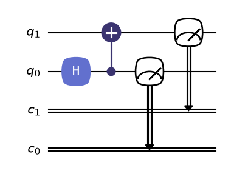
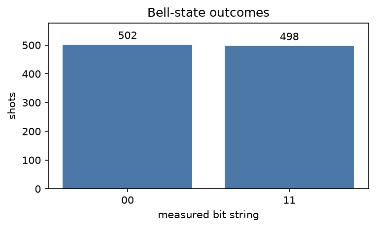

# Build, draw, and run one Program

Use one [`Program`][fatqat.Program] to prepare a Bell pair, draw its circuit,
and run 1,000 shots to see why the measurement results are only `00` and `11`.

## Install FatQat

If you are new to Python, install Python 3.12 or later from
[python.org](https://www.python.org/downloads/). Open PowerShell on Windows,
or Terminal on macOS or Linux. Enter the following commands in that terminal,
one at a time.

Create a folder for your examples:

```sh
mkdir fatqat-learning
cd fatqat-learning
```

Create and activate a virtual environment for this folder:

```powershell
# Windows PowerShell
python -m venv .venv
.venv\Scripts\Activate.ps1
```

```bash
# macOS or Linux
python3 -m venv .venv
source .venv/bin/activate
```

After activation, `python` uses this virtual environment. When you open a new
terminal, return to this folder and activate the environment again; you do not
need to reinstall FatQat.

Install FatQat in the activated environment:

```bash
python -m pip install fatqat
```

<a id="install-the-development-version-from-source"></a>

??? note "Install the development version from source"

    Use this option only if you need the latest development version. Otherwise,
    skip this section. Clone the repository and enter its source folder:

    ```bash
    git clone https://github.com/spaceqat/fatqat.git
    cd fatqat
    ```

    Use [uv](https://docs.astral.sh/uv/) to create a virtual environment and
    install the source. FatQat supports Python 3.12 or later:

    ```bash
    uv venv
    uv pip install .
    ```

    Alternatively, use `pip` from the virtual environment activated earlier,
    while still in the source folder:

    ```bash
    python -m pip install .
    ```

## Save and run a Python file

Using a text editor, create `first_program.py` in your `fatqat-learning`
folder. Copy the complete example below into the file and save it. Python code
goes in this file; terminal commands go in the terminal.

This small example flips one qubit from `0` to `1`, measures it, and prints the
counts:

```python
import fatqat as fq
import fatqat.operations as ops

example_program = fq.Program(1, 1)
example_program.add(ops.X, 0)
example_program.measure_all()
example_result = (
    fq.simulator.Simulator(runtime="numpy")
    .run(example_program, shots=100)
    .result()
)
print(example_result.get_counts())
```

In your terminal, with the environment activated and the current folder set to
`fatqat-learning`, run:

```sh
python first_program.py
```

The output is `{'1': 100}`, meaning all 100 measurements returned 1.

### Run with VS Code { #run-with-vs-code-on-windows }

1. Install [VS Code](https://code.visualstudio.com/) and Microsoft's Python extension.
2. Choose **File > Open Folder**, open `fatqat-learning`, and open `first_program.py`.
3. Open the Command Palette with `Ctrl+Shift+P` on Windows/Linux or
   `Cmd+Shift+P` on macOS. Choose **Python: Select Interpreter** and select the
   interpreter in this folder's `.venv`. If it is not listed, enter its path
   inside your learning folder: `.venv\Scripts\python.exe` on Windows or
   `.venv/bin/python` on macOS/Linux.
4. Save the file. Use the triangle button at the top right of the editor and
   choose **Run Python File in Terminal**.

The output appears in the VS Code terminal panel.

<a id="if-the-example-does-not-run"></a>

??? note "If the example does not run"

    - **Python cannot find the file:** check that your terminal is in the folder
      containing `first_program.py`.
    - **`No module named fatqat`:** activate the environment where you installed
      FatQat. In VS Code, check the selected Python interpreter.
    - **Ubuntu reports that `venv` is unavailable:** for the Python 3.12 supplied
      with Ubuntu 24.04, install `python3.12-venv` with
      `sudo apt install python3.12-venv`, then create the environment again.
      Other releases may use a different package name.
    - **PowerShell blocks the activation script:** you can use the environment
      without activating it. Install with
      `.\.venv\Scripts\python.exe -m pip install fatqat`, then run
      `.\.venv\Scripts\python.exe first_program.py`.

    If you still need help, open a [GitHub issue](https://github.com/spaceqat/fatqat/issues)
    with your operating system, Python version, the command you ran, and the first
    error message.

The `>>>` examples below show an interactive Python session. To copy them
into a `.py` file, remove the `>>>` and `...` prompts and keep only the code,
not the displayed output.

## Write a Bell-state Program

A `Program` records quantum and classical resources together with the instructions
that act on them. This one prepares two qubits in a Bell state and measures both:

```pycon
>>> import fatqat as fq
>>> import fatqat.operations as ops
>>> program = fq.Program(2, 2)
>>> program.add(ops.H, 0)
>>> program.add(ops.CX, (0, 1))
>>> program.measure_all()
```

`Program(2, 2)` creates two qubits and two classical bits. `H` puts qubit 0
into a superposition, and `CX` uses qubit 0 as its control and qubit 1 as its
target. The final instruction writes both quantum outcomes to the classical
bits.

The Program describes *what* to execute. No simulator has been selected,
and no state evolution has taken place yet.

## Inspect the Program

Program uses QuTiP-QIP to draw circuits. By default, it returns a Matplotlib
figure that you can display or save:

```pycon
>>> figure = program.draw()
>>> len(figure.axes)
1
```



??? example "Reproduce this figure"

    ```python
    import matplotlib.pyplot as plt
    import fatqat as fq
    import fatqat.operations as ops

    program = fq.Program(2, 2)
    program.add(ops.H, 0)
    program.add(ops.CX, (0, 1))
    program.measure_all()

    figure, axis = plt.subplots()
    program.draw(ax=axis)
    ```

`program.draw("text")` returns a text representation of the circuit; it does
not print it to the terminal.

## Run it

The general-purpose simulator evolves the Program as a quantum circuit.
`run()` executes the Program and returns a completed
[`Job`][fatqat.Job]. Calling `job.result()` returns a
[`Result`][fatqat.Result] containing the requested outputs, or raises the
recorded execution error:

```pycon
>>> backend = fq.simulator.Simulator()
>>> job = backend.run(
...     program,
...     shots=1000,
...     execution_config={"seed": 7},
... )
>>> result = job.result()
>>> counts = result.get_counts()
>>> sorted(counts)
['00', '11']
>>> sum(counts.values())
1000
```

For this Bell state, each shot returns either `00` or `11`, with equal
probability. Finite sampling introduces random fluctuations, so the two counts
are usually close. A fixed random seed makes the results reproducible.
Use `Result.draw()` to plot the counts.



??? example "Reproduce this figure"

    ```python
    import matplotlib.pyplot as plt
    import fatqat as fq
    import fatqat.operations as ops

    program = fq.Program(2, 2)
    program.add(ops.H, 0)
    program.add(ops.CX, (0, 1))
    program.measure_all()

    result = (
        fq.simulator.Simulator(runtime="numpy")
        .run(program, shots=1000, execution_config={"seed": 7})
        .result()
    )
    counts = result.get_counts()
    assert sorted(counts) == ["00", "11"]
    assert sum(counts.values()) == 1000

    figure, axis = plt.subplots(figsize=(5.2, 3.2))
    result.draw(
        ax=axis,
        title="Bell-state outcomes",
    )
    ```

## Read basis indices

Public subsystem 0 is the most-significant factor. The two-qubit basis is
`|00>`, `|01>`, `|10>`, `|11>` at flat indices 0 through 3. Consequently,
`X(q0)|00>` has its nonzero amplitude at index 2, while `X(q1)|00>` uses
index 1. Count strings use the same left-to-right public slot order: measuring
those states into `(c0, c1)` produces `"10"` and `"01"`, respectively.
