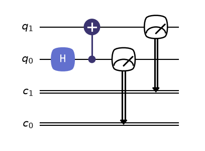
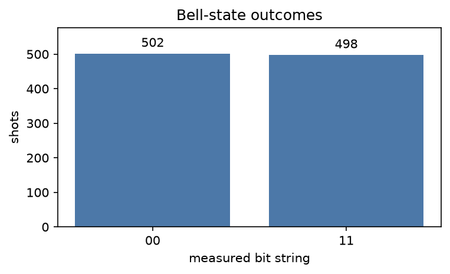

# Build, draw, and run one Program

In about ten minutes, you will create a Bell pair, draw its circuit, run 1,000
shots, and see why only `00` and `11` appear. The computation will live in a
[`Program`][fatqat.Program] from start to finish.

## Install FatQat

If you are new to Python, install Python 3.12 or later from
[python.org](https://www.python.org/downloads/). Open PowerShell on Windows,
or Terminal on macOS or Linux. Enter the following commands in that terminal,
one at a time.

Create a folder for your examples:

```sh
mkdir fatqat-learning
cd fatqat-learning
```

Create and activate a virtual environment for this folder:

```powershell
# Windows PowerShell
python -m venv .venv
.venv\Scripts\Activate.ps1
```

```bash
# macOS or Linux
python3 -m venv .venv
source .venv/bin/activate
```

After activation, `python` uses this environment. Continue with the installation
command below. When you open a new terminal, return to this folder and activate
the environment again; you do not need to reinstall FatQat.

FatQat requires Python 3.12 or later. In a virtual environment, install FatQat:

```bash
python -m pip install fatqat
```

### Install the development version from source

To work with the latest source instead, clone the repository:

```bash
git clone https://github.com/spaceqat/fatqat.git
cd fatqat
```

We recommend [uv](https://docs.astral.sh/uv/) for local projects because it
records the selected Python minor version in `.python-version`. This keeps the
interpreter choice explicit and makes the environment easier to reproduce:

```bash
uv python pin 3.12
uv venv
uv pip install .
```

Keep `.python-version` with the project so later `uv` commands select the same
Python minor version. If you prefer the standard library tools, create and
activate a virtual environment instead:

```bash
python -m venv .venv

# macOS or Linux
source .venv/bin/activate

# Windows PowerShell
.venv\Scripts\Activate.ps1
```

Then install FatQat with `pip`:

```bash
python -m pip install --upgrade pip
python -m pip install .
```

## Save and run a Python file

Create a file named `first_program.py` in your `fatqat-learning` folder using a
text editor. Copy the complete example below into the file and save it. Python
code belongs in this file; terminal commands belong in the terminal. Avoid
naming the file `fatqat.py` or accidentally saving it as `first_program.py.txt`.

This small example flips one qubit from `0` to `1`, measures it, and prints the
counts:

```python
import fatqat as fq
import fatqat.operations as ops

example_program = fq.Program(1, 1)
example_program.add(ops.X, 0)
example_program.measure_all()
example_result = (
    fq.simulator.Simulator(runtime="numpy")
    .run(example_program, shots=100)
    .result()
)
print(example_result.get_counts())
```

In your terminal, with the environment activated and the current folder set to
`fatqat-learning`, run:

```sh
python first_program.py
```

The output is `{'1': 100}`. After editing the file, save it and run the same
command again.

### Run with VS Code on Windows

You can also run the file with a button:

1. Install [VS Code](https://code.visualstudio.com/) and Microsoft's Python extension.
2. Choose **File > Open Folder**, open `fatqat-learning`, and open `first_program.py`.
3. Press `Ctrl+Shift+P`, choose **Python: Select Interpreter**, and select this
   folder's `.venv`. If it is not listed, enter the path to
   `.venv\Scripts\python.exe` inside your learning folder.
4. Save the file. Use the triangle button at the top right of the editor and
   choose **Run Python File in Terminal**.

The output appears in the terminal panel. For later runs, edit, save, and click
the same button.

### If the example does not run

- **Python cannot find the file:** check that your terminal is in the folder
  containing `first_program.py`.
- **`No module named fatqat`:** activate the environment where you installed
  FatQat. In VS Code, check the selected Python interpreter.
- **Ubuntu reports that `venv` is unavailable:** for the Python 3.12 supplied
  with Ubuntu 24.04, install `python3.12-venv` with
  `sudo apt install python3.12-venv`, then create the environment again.
  Other releases may use a different package name.
- **PowerShell blocks the activation script:** you can use the environment
  without activating it. Install with
  `.\.venv\Scripts\python.exe -m pip install fatqat`, then run
  `.\.venv\Scripts\python.exe first_program.py`.

If you still need help, open a [GitHub issue](https://github.com/spaceqat/fatqat/issues)
with your operating system, Python version, the command you ran, and the first
error message.

The rest of this page uses a Bell pair to explain Programs, drawing, and
simulation. Examples beginning with `>>>` show an interactive Python session.
To put those examples in a `.py` file, omit the `>>>` and `...` prompts and any
shown output.

## Write a Bell-state Program

A `Program` records quantum and classical resources together with the instructions
that act on them. This one prepares two qubits in a Bell state and measures both:

```pycon
>>> import fatqat as fq
>>> import fatqat.operations as ops
>>> program = fq.Program(2, 2)
>>> program.add(ops.H, 0)
>>> program.add(ops.CX, (0, 1))
>>> program.measure_all()
```

`Program(2, 2)` creates two qubits and two classical bits. `H` puts qubit 0
into a superposition, and `CX` uses qubit 0 as its control and qubit 1 as its
target. The final instruction writes both quantum outcomes to the classical
bits.

The Program describes *what* should happen. It has not selected a simulator
or performed any evolution yet. FatQat is also extensible: users can define
operations and provide the backend implementations that execute them. Built-in
operations such as `Put`, `Pair`, and `Unpair` show how `AtomArraySimulator` can
represent workflows beyond standard quantum gates.

## Inspect the Program

Drawing is a native Program capability built on QuTiP-QIP's circuit drawing
tools. FatQat translates the Program's instructions for that renderer. The
default renderer returns a Matplotlib figure that you can display or save:

```pycon
>>> figure = program.draw()
>>> len(figure.axes)
1
```



??? example "Reproduce this figure"

    ```python
    import matplotlib.pyplot as plt
    import fatqat as fq
    import fatqat.operations as ops

    program = fq.Program(2, 2)
    program.add(ops.H, 0)
    program.add(ops.CX, (0, 1))
    program.measure_all()

    figure, axis = plt.subplots()
    program.draw(ax=axis)
    ```

For a terminal-friendly version, `program.draw("text")` returns a string
instead of printing it. Drawing is a view of the recorded instruction
structure; it does not run the Program.

## Run it

The general-purpose simulator evolves the Program as a quantum circuit.
`run()` executes the Program and returns a completed
[`Job`][fatqat.Job]. Calling `job.result()` returns a
[`Result`][fatqat.Result] containing the requested outputs, or raises the
recorded execution error:

```pycon
>>> backend = fq.simulator.Simulator()
>>> job = backend.run(
...     program,
...     shots=1000,
...     simulation_config={"seed": 7},
... )
>>> result = job.result()
>>> counts = result.get_counts()
>>> sorted(counts)
['00', '11']
>>> sum(counts.values())
1000
```

Each shot ends as either `00` or `11`: the two measured bits agree because
the qubits are entangled. Their counts are close rather than exactly equal
because measurement samples the state. The fixed seed makes this particular
run reproducible. `Result.draw()` provides a built-in chart for these counts,
so no custom Matplotlib styling is needed.



??? example "Reproduce this figure"

    ```python
    import matplotlib.pyplot as plt
    import fatqat as fq
    import fatqat.operations as ops

    program = fq.Program(2, 2)
    program.add(ops.H, 0)
    program.add(ops.CX, (0, 1))
    program.measure_all()

    result = (
        fq.simulator.Simulator(runtime="numpy")
        .run(program, shots=1000, simulation_config={"seed": 7})
        .result()
    )
    counts = result.get_counts()
    assert sorted(counts) == ["00", "11"]
    assert sum(counts.values()) == 1000

    figure, axis = plt.subplots(figsize=(5.2, 3.2))
    result.draw(
        ax=axis,
        title="Bell-state outcomes",
    )
    ```

## Read basis indices

Public subsystem 0 is the most-significant factor. The two-qubit basis is
`|00>`, `|01>`, `|10>`, `|11>` at flat indices 0 through 3. Consequently,
`X(q0)|00>` has its nonzero amplitude at index 2, while `X(q1)|00>` uses
index 1. Count strings use the same left-to-right public slot order: measuring
those states into `(c0, c1)` produces `"10"` and `"01"`, respectively.

Keep this `Program`: the next chapters change the backend to explore circuit
behavior, hardware constraints, and physical dynamics.

## Continue

- [Write quantum computations with Program](program.md) to use explicit
  registers, measurements, conditions, parameters, and qudits.
- [Choose how much physics to model](execution-models.md) to compare FatQat's
  execution paths.
- [Bring Programs to and from OpenQASM and Qiskit](interoperability.md) to
  connect an existing circuit workflow.
