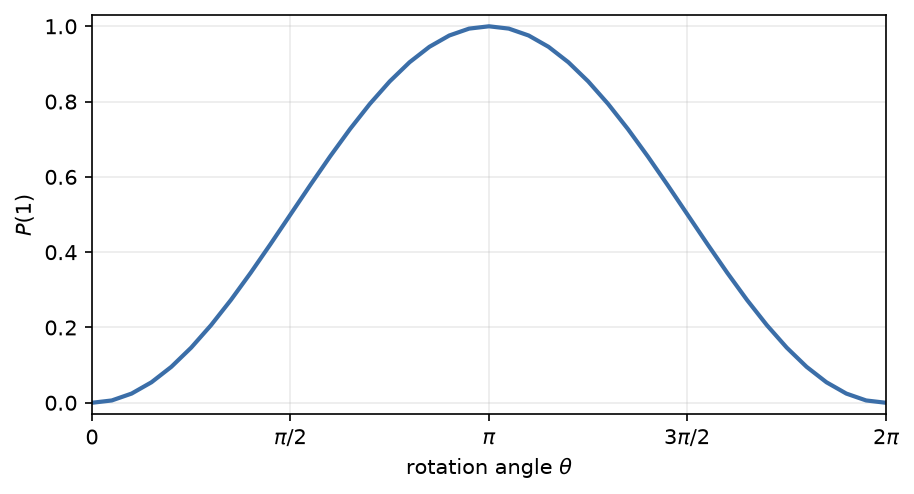

# Simulate a quantum program

Use the general-purpose [`Simulator`][fatqat.simulator.Simulator] to study
circuit behavior, with or without noise. Start here with an ideal single-qubit
rotation: calculate its exact probabilities, sample measurement outcomes,
then vary the rotation angle to see how the probabilities change.

```pycon
>>> import numpy as np
>>> import fatqat as fq
>>> import fatqat.operations as ops
>>> rotation = fq.Program(1, 1)
>>> rotation.add(ops.RY(np.pi / 2), 0)
>>> backend = fq.simulator.Simulator(method="statevector", runtime="numpy")
>>> result = backend.run(rotation).result()
>>> state = result.get_statevector()
>>> probabilities = np.abs(state) ** 2
>>> np.round(probabilities, 6).tolist()
[0.5, 0.5]
```

The statevector contains an amplitude for each basis state. Its squared
magnitudes give the probabilities of measuring `0` and `1`: here, one half
each. No measurements were sampled to obtain these probabilities. The
classical bit declared by `Program(1, 1)` will hold the measurement outcome in
the next example.

`runtime="numpy"` avoids compilation startup for this small circuit.
[Performance and scaling](performance.md) explains when to compare it with
the Numba runtime.

To use NumPy for matrix simulation throughout a script or notebook, set the
default before creating simulators. The initial default is Numba.

```python
import fatqat as fq

fq.simulator.set_default_runtime("numpy")
```

## Choose a simulation method

Set `method` to choose how the simulator represents the state:

- **`statevector`** represents a pure state. With noise, it samples individual
  noise trajectories.
- **`density_matrix`** represents a mixed state and applies noise channels
  directly, without sampling trajectories.

Use `unitary` or `superop` when you need the circuit's full transformation
rather than its output state.

For a worked example using a density matrix to study noise, see
[Ideal and noisy runs](ideal-and-noisy.md).

## Measure a distribution

An exact probability of one half does not mean every set of measurements
splits evenly. Copy the rotation Program and add a measurement into its
classical bit. Each shot runs the circuit from its initial state and produces
one outcome:

```pycon
>>> measured = rotation.copy()
>>> measured.measure(0, 0)
>>> measured_result = backend.run(
...     measured,
...     shots=200,
...     simulation_config={"seed": 7},
... ).result()
>>> counts = measured_result.get_counts()
>>> counts
{'0': 94, '1': 106}
```

The counts record how many shots produced each outcome. Divide them by the
number of shots to obtain the observed frequencies. These fluctuate around
the exact probabilities because measurement is sampled, even though the
circuit has no noise. More shots generally reduce the sampling fluctuations;
they do not change the underlying probabilities. The seed makes this example
repeatable.

[`Result.draw()`][fatqat.Result.draw] can display the counts as frequencies.
The dashed line below marks the exact probability for both outcomes:


??? example "Reproduce this figure"

    ```python
    import matplotlib.pyplot as plt
    import numpy as np
    import fatqat as fq
    import fatqat.operations as ops

    rotation = fq.Program(1, 1)
    rotation.add(ops.RY(np.pi / 2), 0)
    backend = fq.simulator.Simulator(method="statevector", runtime="numpy")
    state = backend.run(rotation).result().get_statevector()
    exact_probability = abs(state[0]) ** 2

    measured = rotation.copy()
    measured.measure(0, 0)
    result = backend.run(
        measured, shots=200, simulation_config={"seed": 7}
    ).result()

    figure, axis = plt.subplots(figsize=(6.2, 3.4))
    result.draw(stat="frequencies", ax=axis, title="200 shots of RY(pi/2)")
    axis.axhline(
        exact_probability, color="C1", linestyle="--", label="Exact probability"
    )
    axis.set_ylim(0.0, 0.65)
    axis.legend()
    figure.tight_layout()
    plt.show()
    ```

## Sweep without rebuilding

How does the probability of `1` change with the rotation angle? Replace the
fixed angle with a [`Parameter`][fatqat.Parameter], then use
[`run_sweep`][fatqat.simulator.Simulator.run_sweep] to evaluate a list of angles
without rebuilding the Program for each value. This is typically faster than
separate `run` calls because the simulator reuses setup work across parameter
values.

```pycon
>>> theta = fq.Parameter("theta")
>>> parameterized_rotation = fq.Program(1)
>>> parameterized_rotation.add(ops.RY(theta), 0)
>>> angles = np.linspace(0.0, 2.0 * np.pi, 9)
>>> sweep = backend.run_sweep(
...     parameterized_rotation,
...     {theta: angles},
...     result_config={"counts": False, "final_state": True},
... ).result()
>>> probability_one = np.array([
...     abs(item.get_statevector()[1]) ** 2 for item in sweep
... ])
>>> np.round(probability_one[[0, 4, 8]], 6).tolist()
[0.0, 1.0, 0.0]
```

The mapping `{theta: angles}` supplies a value of `theta` for each run. The
results follow the same order as `angles`. This Program has no measurements;
each probability comes directly from a statevector, so the curve has no
shot-sampling fluctuations.

For this rotation, \(P(1) = \sin^2(\theta / 2)\). It rises from zero to one
at \(\theta = \pi\), then returns to zero at \(2\pi\). The plot uses a finer
angle grid to show that dependence:



??? example "Reproduce this figure"

    ```python
    import numpy as np
    import matplotlib.pyplot as plt
    import fatqat as fq
    import fatqat.operations as ops

    theta = fq.Parameter("theta")
    rotation = fq.Program(1)
    rotation.add(ops.RY(theta), 0)

    angles = np.linspace(0.0, 2.0 * np.pi, 41)
    backend = fq.simulator.Simulator(method="statevector", runtime="numpy")
    results = backend.run_sweep(
        rotation,
        {theta: angles},
        result_config={"counts": False, "final_state": True},
    ).result()
    probability_one = np.array([
        abs(result.get_statevector()[1]) ** 2 for result in results
    ])

    assert np.allclose(probability_one, np.sin(angles / 2.0) ** 2)

    fig, ax = plt.subplots(figsize=(6.2, 3.4))
    ax.plot(angles, probability_one, color="#3b6ea8", linewidth=2)
    ax.set(
        xlabel=r"rotation angle $\theta$",
        ylabel=r"$P(1)$",
        xlim=(0.0, 2.0 * np.pi),
        ylim=(-0.03, 1.03),
    )
    ax.set_xticks(
        [0.0, np.pi / 2.0, np.pi, 3.0 * np.pi / 2.0, 2.0 * np.pi],
        ["0", r"$\pi/2$", r"$\pi$", r"$3\pi/2$", r"$2\pi$"],
    )
    ax.grid(alpha=0.25)
    fig.tight_layout()
    plt.show()
    ```

For more sweep options, see the [Simulator API](../api/simulator.md).
Continue with [Estimate observables](interpret-results.md) to calculate
correlations and understand the uncertainty of sampled estimates.
