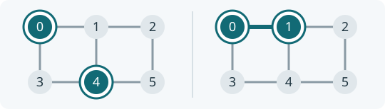
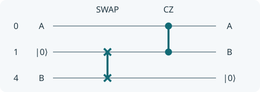

# Simulate a superconducting device

When you prepare a Bell state on a general simulator, you can choose two
qubits and apply gates to them without choosing a device. On a superconducting
processor, each qubit occupies a fixed position. Does the processor support
the gates in your circuit? Are the two positions connected so the qubits can
interact directly?

The [`SCQubitSimulator`][fatqat.simulator.SCQubitSimulator] lets you explore
both questions at the gate level. First, check the gates in a Bell circuit.
Then try the same native two-qubit gate at two different pairs of positions.

## Check which gates the device supports

This Program prepares a Bell state with `H` and `CX`. On the general simulator
you can run it without assigning the qubits to sites on a device.

```pycon
>>> import numpy as np
>>> import fatqat as fq
>>> import fatqat.operations as ops
>>> bell = fq.Program(2, 2)
>>> bell.add(ops.H, 0)
>>> bell.add(ops.CX, (0, 1))
>>> bell.measure_all()
>>> counts = fq.simulator.Simulator(runtime="numpy").run(
...     bell,
...     shots=16,
...     execution_config={"seed": 7},
... ).result().get_counts()
>>> sum(counts.values())
16
>>> set(counts) <= {"00", "11"}
True
```

Now ask the constrained superconducting profile about the same Program. The
profile can report whether it supports `H`, so you do not need to copy its
gate table into application code:

```pycon
>>> profile = fq.simulator.SCQubitSimulator(
...     num_qubits=6,
...     couplings=((0, 1), (1, 2), (3, 4), (4, 5),
...                (0, 3), (1, 4), (2, 5)),
...     runtime="numpy",
... )
>>> profile.implementation_map.supports(ops.H)
False
```

Submitting `bell` would therefore raise
[`UnsupportedOperationError`][fatqat.errors.UnsupportedOperationError]. FatQat does not silently
decompose `H` or `CX` into this profile's native operations.

## Make placement explicit

This device supports `CZ` on connected pairs. The diagram shows two layouts
on the same six-site device. The outlined circles mark the positions assigned
to the two program qubits.



The next Program is native, but placing its two qubits at `0` and `4` asks for
a diagonal `CZ` that the grid does not provide:

```pycon
>>> qubits = fq.QuantumRegister(2, name="q")
>>> readout = fq.ClassicalRegister(2, name="readout")
>>> native = fq.Program([qubits], [readout])
>>> native.add(ops.X, qubits[0])
>>> native.add(ops.X, qubits[1])
>>> native.add(ops.CZ, (qubits[0], qubits[1]))
>>> bad_layout = fq.ResourceLayout({qubits[0]: 0, qubits[1]: 4})
>>> try:
...     profile.run(native, resource_layout=bad_layout)
... except fq.errors.UnsupportedOperationError as error:
...     print(error)
CZGate is not supported on device operands (0, 4)
```

Run the same Program again, this time assigning the second qubit to site `1`.
Sites 0 and 1 share an edge, so the device can apply the gate there.

```pycon
>>> layout = fq.ResourceLayout({qubits[0]: 0, qubits[1]: 1})
>>> state = profile.run(native, resource_layout=layout).result().get_statevector()
>>> state.shape
(4,)
>>> int(np.argmax(np.abs(state) ** 2))
3
```

With the qubits at connected sites, the device can run the gates in this
Program. Keep that placement and add measurements to see how noise affects
the outcome.

## Use the built-in noise model

Copy `native` and add measurements to the copy. Each qubit starts in zero,
so flipping both qubits gives the ideal measurement outcome `11`. Run the
same measured Program at sites 0 and 1, with 100 shots each under ideal
conditions and with the built-in noise model.

```pycon
>>> profile_type = fq.simulator.SCQubitSimulator
>>> noisy_profile = profile_type(
...     num_qubits=6,
...     couplings=((0, 1), (1, 2), (3, 4), (4, 5),
...                (0, 3), (1, 4), (2, 5)),
...     runtime="numpy",
...     noise=profile_type.default_noise_model(),
... )
>>> measured_native = native.copy()
>>> measured_native.measure_all()
>>> options = {"resource_layout": layout, "shots": 100, "execution_config": {"seed": 7}}
>>> ideal_counts = profile.run(measured_native, **options).result().get_counts()
>>> noisy_counts = noisy_profile.run(measured_native, **options).result().get_counts()
>>> print(ideal_counts.get("11", 0), noisy_counts.get("11", 0))
100 92
```

With the seed used here, the ideal simulator returns `11` in all 100 shots.
With the built-in noise model, 92 of the 100 shots return `11`.

## Compare fidelity with and without a SWAP

Suppose qubit A already holds a state at site 0 and qubit B holds one at site 4.
To apply `CZ` to them, we can choose a route through site 1. First exchange the
states at sites 4 and 1 with `SWAP`. B is now next to A, so apply `CZ` at sites
0 and 1. Both outputs are available there. If B starts at site 1, only the
last step is needed.



We specify the route explicitly. In this implementation the exchange takes three
`CX` gates, each realized with one native `CZ` and single-qubit gates. Including
the final gate, the routed circuit uses four native `CZ` gates and the direct
circuit uses one.

Prepare both logical qubits in the plus state so that `CZ` changes their
relative phase. Compare the final state of A and B with the ideal output.
A state fidelity of one means the states match exactly.

??? example "Code for both layouts and the fidelity calculation"

    ```python
    import numpy as np
    import fatqat as fq
    from fatqat import operations as ops

    def hadamard(program, target):
        program.add(ops.RZ(np.pi / 2), target)
        program.add(ops.SX, target)
        program.add(ops.RZ(np.pi / 2), target)

    def cx(program, control, target):
        hadamard(program, target)
        program.add(ops.CZ, (control, target))
        hadamard(program, target)

    def output_fidelity(*, start_site, noise=None):
        q = fq.QuantumRegister(3, name="q")
        program = fq.Program([q])
        # q[0], q[1], q[2] are at physical sites 0, 1, 4 respectively.
        layout = fq.ResourceLayout(dict(zip(q, (0, 1, 4))))
        hadamard(program, q[0])
        b = {1: q[1], 4: q[2]}[start_site]
        hadamard(program, b)
        if start_site == 4:
            # Move the logical state at site 4 to its neighbour at site 1.
            cx(program, q[2], q[1])
            cx(program, q[1], q[2])
            cx(program, q[2], q[1])
        program.add(ops.CZ, (q[0], q[1]))
        sim = fq.simulator.SCQubitSimulator(
            num_qubits=6,
            couplings=((0, 1), (1, 2), (3, 4), (4, 5), (0, 3), (1, 4), (2, 5)),
            method="density_matrix", runtime="numpy", noise=noise,
        )
        result = sim.run(
            program, resource_layout=layout, shots=0, result_config={"final_state": True}
        ).result()
        rho = result.get_density_matrix()
        # Discard the spare qubit. Both logical outputs now occupy sites 0 and 1.
        pair = np.trace(rho.reshape(4, 2, 4, 2), axis1=1, axis2=3)
        target = np.array([1, 1, 1, -1]) / 2  # CZ applied to |++>
        return float(np.real(target.conj() @ pair @ target))
    ```

```pycon
>>> noise = fq.simulator.SCQubitSimulator.default_noise_model()
>>> for b_site in (1, 4):
...     ideal = output_fidelity(start_site=b_site)
...     noisy = output_fidelity(start_site=b_site, noise=noise)
...     print(f"(0, {b_site})  {ideal:.2%}  {noisy:.2%}")
(0, 1)  100.00%  99.74%
(0, 4)  100.00%  99.39%
```

Both layouts reach the same ideal state. With the built-in noise model, the
extra gates lower the output-state fidelity from 99.74% to 99.39% for this input.
